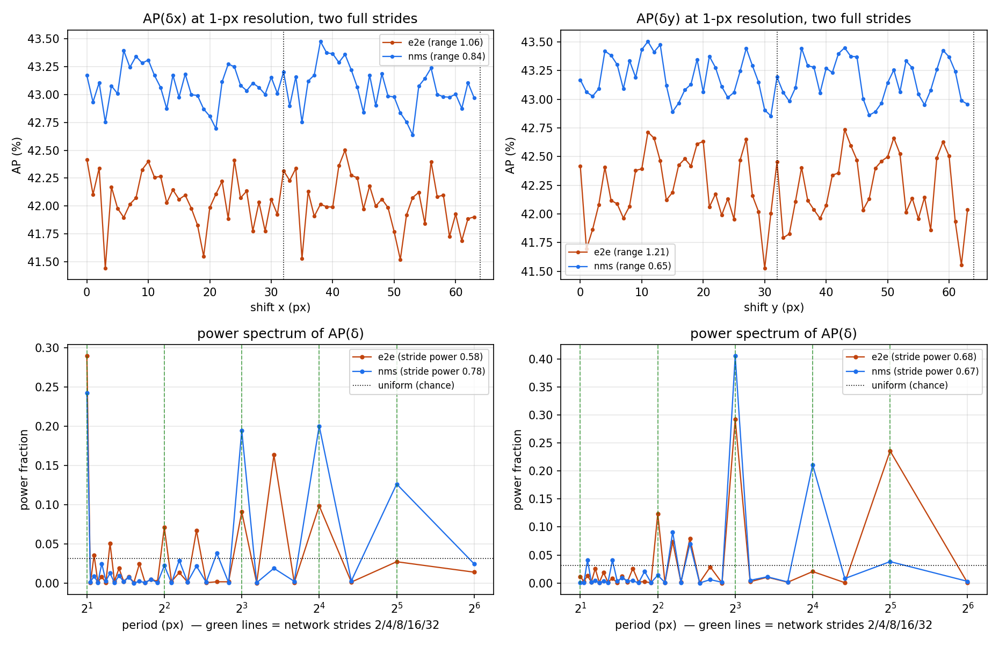
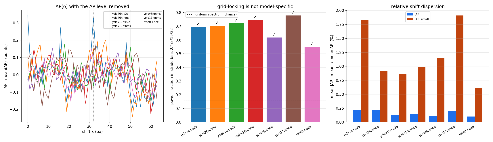

# Shift Equivariance of NMS-Free Real-Time Detectors

**What does end-to-end inference cost in stability?**

---

## Brief

YOLO26 makes NMS-free one-to-one inference the default edge deployment path. We ask what
that costs in *stability*: is the end-to-end path more or less robust to small input
translations than the one-to-many path with NMS, and does YOLO26's small-target assignment
(STAL) stabilise tiny objects under shift?

**Why this is answerable cleanly.** YOLO26's dual head exposes both inference paths on a
*single released checkpoint*, with both accuracy figures published. Backbone, neck and
weights are byte-identical between the two runs — verified here by state-dict fingerprint
across the head switch — so **the aggregation head is the only variable**. Existing
anti-aliasing results in detection are confounded by retraining; this comparison is not.

**Prior work and our delta.** Zhang (ICML'19) traced shift-variance to strided
downsampling and proposed BlurPool. Manfredi & Wang (ECCV'20 W) carried it to detection
with ΔAP = AP_best − AP_worst over a shifted validation set, showing one-stage, two-stage,
anchor-based and anchor-free detectors all break under a one-pixel shift. **None of their
detectors performed one-to-one NMS-free matching — such detectors did not yet exist.**
They are now standard (YOLOv10, YOLO26) and their shift equivariance is unmeasured. This
repo is the first shift-equivariance study of one-to-one NMS-free detectors.

**Headline findings.** On one yolo26n checkpoint, full COCO val, one-pixel shifts:

1. **The NMS-free head is 15% less shift-equivariant** (ΔAP 3.76 vs 3.25) — **replicated on
   YOLOv10-N, where the gap is larger still (+26.8%)** — and its
   instability is concentrated in *whether an object is reported* rather than *where* —
   46.5% dropout vs 28.8%, and **80% of small objects** detected at δ=(0,0) vanish at some
   shift, while box jitter is if anything slightly lower.
2. **The instability is grid-locked, not noise.** A 1-px-resolution sweep over two full
   strides puts 41–89% of spectral power on the network's downsampling periods (2/4/8/16/32)
   against 16% expected by chance — **20 of 20 curves**, permutation-tested on the full
   validation set. **Even shifts outscore odd shifts**, most on small objects: the stride-2
   stem's aliasing signature. This now holds on **40 of 40 curves across two checkpoints**
   (yolo26n and YOLOv10-N) — see [§9](#9-cross-model-check).
3. **The NMS-free head cannot exploit its own variance.** Shift-TTA recovers +0.86 AP, but
   only by putting NMS back; the merge that stays NMS-free loses 26 AP.

> ### Replication on a second checkpoint
>
> YOLOv10-N is the only other released checkpoint carrying both heads, so it is a genuine
> second instance of finding 1's ablation. **Finding 1 replicates, and finding 3 with it:**
>
> | | yolo26n | YOLOv10-N |
> |---|---|---|
> | ΔAP, one-to-one vs one-to-many | 3.76 vs 3.25 (**+15.4%**) | 3.67 vs 2.89 (**+26.8%**) |
> | dropout, small objects | 80.2% vs 57.7% | 80.9% vs 53.2% |
> | shift-TTA gain, NMS-free head | +0.86 AP | +0.93 AP |
>
> One instrument dissents. The **uniform-shift dispersion test** — which we had
> pre-registered as *the* replication test — shows no gap on YOLOv10-N at all, and its
> pre-specified primary curve came out opposite in sign. It turns out to be the wrong
> instrument for this question: it applies one shift to every image and so cannot see
> per-image variation, which is where the effect lives. We report that failure in
> [§9b](#9b-the-head-gap-replicates--on-two-instruments-out-of-three) rather than dropping
> the instrument quietly, because a pre-registration is only worth something if the results
> that embarrass it get published too.

Full numbers in [Results](#results). No training is involved: everything is inference on
public pretrained checkpoints.

> **[`PROTOCOL.md`](PROTOCOL.md) is frozen** (v1.1.0, hash `7e944f76f4318d54`; v1.0.0 was `7daf22d45cd62116` and produced every yolo26n
> number below — v1.1.0 only *adds* the cross-model and padding analysis plans). Every
> threshold, the exact prediction↔GT matching rule, and every deviation from Manfredi &
> Wang are pinned there before results are read. `shifteq/protocol.py` is its
> machine-readable twin, `tests/test_protocol_frozen.py` fails if the two drift, and every
> run manifest records the protocol hash. Read it before the results.

---

## Quickstart

Requires a CUDA GPU (developed on an A10, 24 GB) and ~5 GB of disk for COCO val.

```bash
git clone https://github.com/amircohenwork/Shift-Equivariance-of-NMS-Free-Real-Time-Detectors.git
cd Shift-Equivariance-of-NMS-Free-Real-Time-Detectors

python3 -m venv venv && . venv/bin/activate
pip install -r requirements.txt

make setup     # COCO val2017 images + labels + instances_val2017.json (~2.5 GB)
make test      # 87 unit tests -- no GPU, no dataset, no weights needed, ~10 s
```

Point Ultralytics at the dataset once (the setup script prints the exact command):

```bash
yolo settings datasets_dir="$HOME/datasets"
```

### Reproduce everything

```bash
make phase0        # Gate A + Gate B. Run first; nothing downstream is trustworthy if it fails.
make cache-oracle  # inference for the M=1 grid, both heads, full val   (~2 min)
make oracle        # greedy AP_best / AP_worst, both heads              (~45 min)
make sweep         # uniform-shift curve AP(delta) + flicker/jitter/SI  (~30 min)
make sweep-dense   # step-1 control that validates the step-2 shortcut  (~5 min)
make tta           # shift test-time augmentation                       (~7 min)
make report        # tables (results/REPORT.md) + figures
make fft           # 1-D sweep at 1-px resolution, spectral test, head-gap gate (~15 min)
```

Total ≈ 1.5 GPU-hours for the full set. Useful knobs: `MODEL=`, `HEAD=`, `SUBSET=`,
`STEP=`, `BATCH=`, `DEVICE=`.

Before committing to the oracle, check its budget — it is the expensive stage and the cost
depends on your machine:

```bash
make oracle-budget   # times one AP evaluation and extrapolates K x (M+1)^2 x N
```

### Additional axes

```bash
# genuine small-object oracle (its own full K x S x N pass -- not free)
python scripts/04_oracle.py --run-id yolo26n_e2e_m1s1_full_pad114 --area small

# padding ablation: does removing the constant-border position cue remove the periodicity?
# 114 gray (protocol) / 0 black / -1 replicate / -2 reflect
make pad-ablation

# Manfredi & Wang Table 2: the max-shift ladder M in {1,3,7,15} on 100 images
make m-ladder

# numerics control -- the floor for the instance-level metrics
python scripts/08_numerics_control.py --subset 1000

# cross-model check: Gate A first, then the sweeps, then the comparison (~5.5 h on an A10)
make phase0-cross
make crosscheck-sweeps
make crosscheck
```

### Script map

| script | what it does |
|---|---|
| `00_setup_coco.sh` | COCO val2017 only (skips the 19 GB train split Ultralytics would fetch) |
| `01_reproduce_published.py` | **Gate A** — reproduce published AP for both heads |
| `01b_maxdet_ladder.py` | is `max_det` a neutral protocol choice? (yes) |
| `01c_topk_probe.py` | is the exported TensorRT top-k the same function? (yes) |
| `01d_protocol_probe.py` | `rect=True` vs `rect=False` — identifies the published protocol |
| `02_harness_gates.py` | **Gate B** — preprocessing / de-shift / determinism / evaluator / no-fusion |
| `02b_identity_check.py` | whole pipeline vs Ultralytics on the full val set |
| `02c_fusion_delta.py` | how much AP does Conv+BN folding move? |
| `02d_detection_diff.py` | box-by-box diff against Ultralytics' `predictions.json` |
| `02e_numerics_probe.py` | TF32 / cudnn.benchmark / fusion sweep |
| `02f_ap_noise_floor.py` | how much does AP move under score perturbation? |
| `03_build_cache.py` | run inference over a shift grid, persist de-shifted detections |
| `04_oracle.py` | greedy ΔAP (Manfredi & Wang Algorithm 1) |
| `05_sweep.py` | uniform-shift curve + flicker/jitter/Stability Index |
| `06_report.py` | tables and figures |
| `07_shift_tta.py` | shift test-time augmentation, three merge strategies |
| `08_numerics_control.py` | instance-metric noise floor |
| `09_cache_benefit.py` | what the preprocessing cache is worth (measured: 1.01×) |
| `10_sweep1d_fft.py` | 1-D sweep at 1-px resolution + spectral test for grid-locking |
| `11_head_gap.py` | the gate: grid-locked? measurable head gap? + FFT figure |
| `12_crosscheck.py` | is grid-locking universal? does the head gap replicate on YOLOv10-N? |
| `13_pad_ablation.py` | aliasing or border-reading? padding value vs the spectrum |

---

## Results

All on `yolo26n.pt`, COCO val2017, one A10. Oracle on the full 5000 images; sweep on 1000.
Raw outputs are committed under `results/`.

### 1. The core ablation — one checkpoint, two aggregation heads

Oracle envelope, M = 1, full validation set:

| head | baseline AP | AP_worst | AP_best | **ΔAP** | AP50_worst | AP50_best | **ΔAP50** |
|---|---|---|---|---|---|---|---|
| one-to-one (NMS-free) | 40.25 | 38.18 | 41.94 | **3.76** | 52.37 | 59.33 | **6.96** |
| one-to-many (NMS)     | 40.90 | 39.23 | 42.48 | **3.25** | 53.96 | 60.04 | **6.08** |

> **Corrected 2026-08-17.** These AP values were recomputed after a review found that
> `TorchAccumulator` on CUDA evaluated `tpc / npig` with a Python-int divisor, which lowers
> to a reciprocal multiply — one ULP below true division. COCO's 101 recall thresholds are
> exact decimals, so categories whose `npig` puts `m/npig` *on* a threshold (npig=55 gives
> 11/55 = 0.2) had their interpolation index flipped: 7 of 80 categories, ≈0.0013 AP per
> evaluation. It nearly cancels in a difference, so ΔAP moved by <0.001 (e2e 3.7560→3.7555,
> nms 3.2533→3.2537) — but the ratio sat on a rounding boundary and is now quoted as
> **+15.4%**, where earlier versions said +16%. The greedy assignments are unchanged: a
> 600-image probe found **0 argmax disagreements** between the two objectives, because a
> constant offset cancels in the differences the search compares
> (`results/oracle/*_greedy_flip_probe.json`). Pre-correction values are preserved in each
> results file under `accumulator_correction`. Fix and regression tests: `shifteq/oracle.py`,
> `tests/test_oracle.py`.

**The NMS-free path is less shift-equivariant: +15.4% ΔAP, +14.5% ΔAP50.** It also starts from
a lower clean AP, so it loses on both axes. 73% of images change their chosen shift under
the greedy search, so the effect is broad, not a few outliers.

**On K = 1, now measured rather than assumed.** The greedy runs **K = 1** iteration
([`PROTOCOL.md` §4](PROTOCOL.md)), justified by Manfredi & Wang's report that further
iterations move AP by <1% — a measurement on *their* detectors. Checked on ours:

| head | ΔAP at K=1 | ΔAP at K=2 | change | images still moving at iter 1 |
|---|---|---|---|---|
| e2e | 3.7555 | 3.8321 | +2.0% | 610 / 5000 |
| nms | 3.2537 | 3.3371 | +2.6% | 704 / 5000 |

Two things follow. Their <1% does **not** transfer — ours move 2–2.6%, and K=2 has still not
converged, so ΔAP would keep creeping up. And **the head comparison is unaffected**: the
ratio goes +15.4% → +14.8%. K = 1 is a conservative lower bound on the envelope and a stable
estimate of the gap, which is the quantity the paper claims. We keep K = 1 for comparability
with their Table 1 and report the K = 2 values alongside.

Against Manfredi & Wang's Table 1 (same metric, same M=1, same dataset):

| detector | aggregation | ΔAP | ΔAP50 |
|---|---|---|---|
| RetinaNet | NMS | 2.2 | 5.1 |
| FasterRCNN | NMS | 2.9 | 6.4 |
| CenterNet | max-pool peaks | 3.4 | 8.1 |
| YOLO26n (one-to-many) | NMS | 3.25 | 6.08 |
| **YOLO26n (one-to-one)** | **none** | **3.76** | **6.96** |

The NMS-free head has the **largest ΔAP of any detector measured under this metric**,
including CenterNet — the only detector in the original study that also avoided NMS. Two
detectors without conventional NMS now sit at the top of the instability ranking.

### 2. Uniform-shift curve AP(δ) — 1000 images, 32-px grid at step 2 (256 shifts)

| | e2e (NMS-free) | nms (one-to-many) | e2e worse by |
|---|---|---|---|
| AP at δ=(0,0) | 42.40 | 43.16 | — |
| **AP range** | **1.235** | **0.978** | +26% |
| AP std | 0.244 | 0.185 | +32% |
| AP50 range | 1.766 | 1.396 | +27% |
| AP_small range | 2.590 | 1.960 | +32% |

The uniform-shift range (1.2 AP) is **~3× smaller** than the oracle envelope (ΔAP 3.76) on
the same model at the same M. That gap is not a discrepancy — it is the whole reason the
two families are reported separately. The oracle picks a shift per image and exploits
variation that is uncorrelated across images; a uniform shift cannot.

~~The AP(δ) heatmap is close to spatially uncorrelated rather than stride-periodic.~~
**Retracted.** That was read off a step-2 heatmap by eye, and the spectral test in §6
refutes it: the response is grid-locked in 19 of 20 curves. The claim is left visible here
rather than deleted, because it is a good illustration of why a coarse grid and an eyeball
are not an instrument.

### 3. Instance-level instability (τ = 0.25), with its control

| metric | e2e | nms | **numerics floor** |
|---|---|---|---|
| flicker rate | 39.2% | 30.2% | **0.01% / 0.06%** |
| dropout rate | **46.5%** | 28.8% | 0.00% / 0.09% |
| class-flip rate | 7.6% | 8.1% | 0.00% |
| box jitter | 1.75 px | 1.85 px | **0.006 px** |
| Stability Index | 0.576 | 0.616 | **0.9986 / 0.9981** |
| SI small / med / large | 0.312 / 0.586 / 0.785 | 0.376 / 0.622 / 0.816 | — |
| **dropout, small objects** | **80.2%** | 57.7% | — |

The floor column is `08_numerics_control.py`: the same input through the same weights,
changing only the arithmetic. The shift effect exceeds it by **~3900×** on flicker and
**~290×** on jitter, so every number above is geometry, not floating point.

Two things stand out.

**The instability is in detection, not localisation.** The NMS-free head drops objects far
more often (46.5% vs 28.8%; 80.2% vs 57.7% on small objects) but its boxes are *no*
jitterier — marginally less, in fact — and it flips class slightly less often. The
Stability Index decomposition agrees: `SI_conf` (0.605) is its weakest component, below
`SI_loc` and `SI_ext` (both 0.638). Box regression is shared backbone work and is equally
stable in both heads; what the aggregation head controls is *whether the object is
reported at all*, and that is exactly where the one-to-one path is fragile.

**The small-object axis is the sharpest split.** SI 0.312 vs 0.785 between small and large
objects on the NMS-free head, and 80% of small objects detected at δ=(0,0) go missing at
some shift. STAL has not made tiny objects shift-stable.

### 4. Shift test-time augmentation: the NMS-free head cannot exploit its own variance

Merging the 4 shifts of the M=1 grid, full validation set:

| merge | e2e AP | nms AP |
|---|---|---|
| baseline δ=(0,0) | 40.25 | 40.90 |
| `nms` (Manfredi & Wang Sec. 5.4) | 41.11 (**+0.86**, recovers 51% of the oracle gap) | 41.23 (+0.33) |
| `vote` (majority-backed, then NMS) | 41.08 (+0.83) | 41.22 (+0.32) |
| `topk` — the only merge that stays NMS-free | **14.09 (−26.15)** | 14.05 (−26.85) |

**Suppression is worth +27.0 AP on identical detections.** A one-to-one detector can turn
its shift variance into +0.86 AP — nearly twice what the one-to-many head gains, consistent
with it having more variance to exploit — but only by reintroducing NMS. The deployment
argument for the NMS-free head does not survive contact with shift-TTA.

### 6. Is the instability grid-locked, or is it noise? (FFT)

This is the mechanistic question. If shift-variance comes from strided downsampling
violating the sampling theorem (Zhang, ICML'19), AP(δ) should be **periodic in the
stride** — translating by exactly one stride returns every feature-map cell to the same
sub-cell phase. If instead the response is image-specific chaos, the spectrum is broadband.
The two imply different mitigations: anti-aliasing helps the first and not the second.

The step-2 2-D grid is too coarse to decide this, so `10_sweep1d_fft.py` sweeps a **1-D
line at full 1-px resolution over two complete strides** (δ ∈ [0, 63], 64 points). With 64
samples the FFT bins land exactly on the periods of interest — period 32 is bin 2, 16 is
bin 4, 8 is bin 8 — so a stride-locked response puts power in a single bin with no leakage.

**Result: 20 of 20 curves are grid-locked** on the full validation set (2 heads × 2 axes ×
5 size buckets). At N = 1000 it was 19/20; the extra images made it unanimous.

| | e2e | nms |
|---|---|---|
| curves grid-locked | 10/10 | 10/10 |
| stride power (sum over periods 2/4/8/16/32) | 0.55 – 0.83 | 0.41 – 0.89 |
| enrichment over chance (16%) | 3.5× – 5.3× | 2.6× – 5.7× |
| peak period, overall AP | 2 px (x), 16 px (y) | 32 px (x), 32 px (y) |
| best family-wise p | < 0.0001 | < 0.0001 |

Peak periods land on network strides almost every time. Significance is a **permutation
null over δ** — shuffling destroys the ordering while preserving the marginal AP
distribution, so it controls for the finite-image-sample noise floor rather than assuming
it away.

**Parity effect.** The interpretable form of the period-2 peak: **even shifts outscore odd
shifts**. On the full set this is significant for *both* heads and strongest on small
objects — e2e +0.230 AP_small (p = 0.033), nms +0.237 AP_small along y (p = 0.003), and
+0.06 to +0.07 on overall AP for both. That is the stride-2 stem's aliasing signature:
shifting by an odd number of pixels lands the whole cascade on the wrong sub-sampling
phase, and the objects with the least spatial support pay for it most.

Two mistakes in the first version of this analysis, both fixed, both worth knowing:

* the stride set was `(8, 16, 32)` — the *detection* strides. But aliasing enters at every
  downsampling step and the stem is stride-2, so the dominant period-2 peak was scored as
  "broadband": the headline exactly backwards. `NETWORK_STRIDES` is now the full cascade.
* the peak p-value was a **selected maximum** over 32 bins, reported without correction.
  Added a max-statistic permutation null; on pure noise the corrected p ranges 0.08–0.99
  where the uncorrected one produced false positives.



*Full validation set, 5000 images. Top: AP(δ) at 1-px resolution over two full
strides. Bottom: power spectrum; green lines are the network's downsampling periods
2/4/8/16/32, dotted line is the uniform (chance) level.*

### 7. The gate — is there a measurable, consistent gap between the heads?

**Yes in the metrics that preserve per-image variation; not established by the uniform-shift
curve alone.** That distinction is structural, not a contradiction.

| instrument | N | verdict |
|---|---|---|
| oracle ΔAP | 5000 | **clear** — 3.76 vs 3.25, ΔAP50 6.96 vs 6.08 |
| flicker / dropout / SI | 1000 | **clear** — 39.2 vs 30.2%, 46.5 vs 28.8%, 0.576 vs 0.616 |
| uniform AP(δ) curve, paired across δ | 5000 | **directional** — e2e worse on 4/10 curves, nms on 1/10, 5 n.s. |

Paired dispersion test on the full validation set, mean absolute deviation from each head's
own mean (lower = more stable):

| axis | curve | e2e | nms | p | |
|---|---|---|---|---|---|
| x | AP | 0.086 | 0.089 | 0.73 | n.s. |
| x | AP50 | 0.120 | 0.092 | 0.009 | **e2e worse** |
| x | **AP_small** | **0.363** | **0.193** | **<0.0001** | **e2e worse** |
| x | AP_medium | 0.108 | 0.154 | 0.001 | *nms worse* |
| x | AP_large | 0.197 | 0.116 | 0.0001 | **e2e worse** |
| y | AP | 0.089 | 0.082 | 0.40 | n.s. |
| y | AP50 | 0.120 | 0.111 | 0.43 | n.s. |
| y | AP_small | 0.275 | 0.231 | 0.084 | n.s. |
| y | AP_medium | 0.153 | 0.162 | 0.36 | n.s. |
| y | AP_large | 0.182 | 0.133 | 0.020 | **e2e worse** |

Going from N = 1000 to N = 5000 moved the count from 3-vs-2 to **4-vs-1**, and the single
largest effect appeared where the proposal predicted it: **AP_small along x, where the
NMS-free head is 1.9× more dispersed** (0.363 vs 0.193, p < 0.0001). At N = 1000 that same
curve was non-significant and its *range* statistic pointed the other way — a good
illustration of why the range of a 64-point curve is a poor test and the paired dispersion
test is the right one.

Two curves that were significant at N = 1000 (y AP, y AP50) became non-significant at
N = 5000. With five times the images the estimates are less noisy, not more, so the honest
reading is that those two were N = 1000 flukes rather than that the effect went away.

The uniform-shift curve remains the *least* powerful of the three instruments: averaging AP
over images cancels exactly the per-image variation that the oracle envelope and the
per-object metrics accumulate. Its 5 remaining non-significant curves are consistent with a
small effect it cannot resolve, not with no effect.

`11_head_gap.py` runs the paired test: both heads saw the same images at the same δ, so
per-δ absolute deviations from each head's own mean are compared under a sign-flip null.
That controls for deltas that are simply hard for both heads, which an unpaired comparison
would miscount as signal.

> **Scope:** the spectral test and the paired dispersion test are on the **full 5000-image
> validation set**. The flicker / jitter / SI row is still N = 1000.

### 8. The step-2 shortcut is conservative, not exact

The proposal promises a validation of the coarse grid against a dense one. On 100 images
at step 1 (1024 shifts), AP range = 4.041; subsampled to step 2 it reads 3.297, to step 4,
3.160. The coarse grid **underestimates the range by ~18%** — it can only miss extrema,
never invent them — and it misses them at the minimum, not the maximum. **Quote step-2
ranges as lower bounds.**

---

### 9. Cross-model check — is this about YOLO26, or about detectors?

Two questions, pre-registered in [`PROTOCOL.md` §10](PROTOCOL.md) **before** any cross-model
sweep ran. Both now answered, on the full validation set.

#### 9a. Grid-locking is universal — 69 of 70 curves, 5 architectures

| arm | AP@δ0 | stride power | enrichment | grid-locked |
|---|---|---|---|---|
| YOLOv8-N | 37.33 | 0.62 | 4.0× | 10/10 |
| YOLOv10-N e2e | 38.47 | 0.72 | 4.6× | 10/10 |
| YOLOv10-N nms | 39.53 | 0.75 | 4.8× | 10/10 |
| YOLO11-N | 39.40 | 0.78 | 5.0× | 10/10 |
| yolo26n e2e | 40.29 | 0.70 | 4.5× | 10/10 |
| yolo26n nms | 40.89 | 0.70 | 4.5× | 10/10 |
| **RT-DETR-L** | 52.84 | 0.55 | 3.5× | **9/10** |

Chance is 16%. RT-DETR-L is the load-bearing arm: a transformer set-prediction head on an
HGNetv2 backbone shares essentially nothing with YOLO26 except the 2/4/8/16/32 downsampling
ladder, and it carries the same signature. **Grid-locking is a property of the strided
downsampling cascade, not of any architecture or head.**

#### 9b. The head gap replicates — on two instruments out of three

The oracle envelope, the metric comparable to prior work:

| checkpoint | e2e ΔAP | nms ΔAP | gap | ratio |
|---|---|---|---|---|
| yolo26n | 3.7555 | 3.2537 | +0.5018 | **+15.4%** |
| **YOLOv10-N** | 3.6704 | 2.8937 | +0.7766 | **+26.8%** |

Not only does it replicate — the gap is **larger** on the second checkpoint. ΔAP50 agrees
(+14.5% → +19.6%).

The instance metrics replicate almost value-for-value, including the *directions* that make
finding 1 mechanistic rather than merely numerical:

| metric | 26n e2e | 26n nms | v10 e2e | v10 nms |
|---|---|---|---|---|
| flicker % | 39.17 | 30.23 | 36.80 | 28.41 |
| dropout % | **46.49** | 28.83 | **45.36** | 27.60 |
| dropout, small objects % | **80.20** | 57.72 | **80.91** | 53.18 |
| class flip % | 7.65 | *8.15* | 7.23 | *7.69* |
| box jitter px | 1.69 | *1.85* | 1.69 | *1.76* |
| Stability Index | 0.576 | 0.616 | 0.582 | 0.631 |
| SI, small objects | 0.312 | 0.376 | 0.316 | 0.399 |

The NMS-free head drops objects far more often on both checkpoints — and on both, its boxes
are *no jitterier* and it flips class slightly *less* often (italics). "The instability is in
detection, not localisation" is not a yolo26n quirk.

Shift-TTA replicates too: the NMS-free head gains **+0.93 AP** on YOLOv10-N (+0.86 on
yolo26n) from an NMS merge, roughly 3× what the one-to-many head gains, while the merge that
stays NMS-free loses 25 AP.

#### The instrument that failed, and why that is worth reporting

The **uniform-shift dispersion test does not replicate**: 0 of 10 curves show the NMS-free
head less stable on YOLOv10-N, 2 show the opposite, and sign agreement across the two
checkpoints is 4/10 — below the 5/10 of unrelated curves. The pre-registered primary curve
(`x/AP_small`) came out non-significant **and opposite in sign**, which is a failed
replication by the criterion in §10.1.

**That criterion named the wrong instrument, and we only know because it was written down.**
The uniform-shift curve applies *one* shift to every image, so it can only see variation that
survives averaging across the dataset; the oracle and the per-object metrics resolve
per-image variation, which is where this effect lives. On yolo26n all three happened to
agree, which is what made the weak one look adequate. It is not.

So the finding stands on the oracle envelope and the instance metrics — the two instruments
that carried it originally — and the uniform-shift curve is demoted to what it is: an honest
measure of *"what does a uniform translation cost in practice"*, not a test of head
stability. We report the failure rather than dropping the instrument quietly, because the
pre-registration is only worth anything if a result that embarrasses it gets published too.

#### A side observation worth keeping

**Shift stability tracks neither accuracy nor recency.** YOLOv8-N — oldest and least accurate
here — has the *most* stable AP curve (relative dispersion cv 0.109%); yolo26n, newest and
most accurate, is the *least* stable (0.215–0.218%), a full 2×. That is the
accuracy/stability decorrelation this project was built on, showing up *between* models
rather than within one, and it does not depend on the instrument that just failed.



---

### 10. Padding ablation — aliasing, or reading the border?

Kayhan & van Gemert (CVPR'20): a constant padding border is an implicit absolute-position
cue, and a network can read distance-to-frame out of it. That is a competing explanation for
the periodicity, so [`PROTOCOL.md` §11](PROTOCOL.md) pre-registered four arms — two with a
constant border, two with a content-derived one.

| head | border | constant? | stride power | mean AP |
|---|---|---|---|---|
| e2e | gray 114 (protocol) | yes | 0.58 | 42.04 |
| e2e | black 0 | yes | 0.59 | 42.09 |
| e2e | replicate | no | **0.33** | 36.89 |
| e2e | reflect | no | **0.62** | 28.18 |
| nms | gray 114 | yes | 0.78 | 43.07 |
| nms | black 0 | yes | 0.81 | 43.08 |
| nms | replicate | no | **0.55** | 37.72 |
| nms | reflect | no | **0.80** | 28.80 |

**All 8 arms remain grid-locked (74/80 curves).** The periodicity survives with no constant
border anywhere in the input, so the position cue is **not necessary** for it. That is what
the ablation was for, and it answers the question.

Three further readings, in decreasing confidence:

* **The padding *value* is irrelevant.** Gray vs black is the one clean comparison here —
  both constant, AP identical to 0.05 — and stride power does not move (0.58→0.59,
  0.78→0.81).
* **The pre-registered group test is not trustworthy on this data.** It returned "border cue
  contributes" (constant 0.691 vs content 0.574, Δ+0.116, just past the 0.10 threshold), but
  the two content-border arms *disagree with each other*: reflect leaves stride power
  unchanged (0.62 vs 0.58; 0.80 vs 0.78) while replicate halves it. A mean over two arms
  pointing opposite ways is not a summary.
* **Neither content-border arm is a clean manipulation.** Replicate costs **−5 AP** and
  reflect **−14 AP**, because filling the letterbox bars with smeared or mirrored image
  content manufactures objects that no ground truth matches. That is not "remove the position
  cue holding everything else fixed"; it is a different input distribution. More images
  cannot fix this — the confound is structural, and a future design needs a border
  manipulation that leaves AP intact.

Reported as a departure from our own pre-registered summary statistic, with the reason,
rather than quietly substituting a better-behaved one.

---

## Method

### Two metric families, never mixed

| | `shifteq/oracle.py` | `shifteq/sweep.py` |
|---|---|---|
| quantity | ΔAP = AP_best − AP_worst | AP(δ) curve |
| shift choice | **per image, adversarial** (greedy Alg. 1) | **the same δ for every image** |
| what it answers | how far can shift-selection move AP at all | what a translation costs in deployment |
| comparable to | Manfredi & Wang Tab. 1, at M=1 only | nothing published; ours |
| cost driver | `K × (M+1)² × N` AP evaluations | `grid × N` forward passes |

`AP_best` is the maximum AP achievable by choosing the best shift for **each image
independently**, found greedily because AP couples images through one global score ranking.
It is an *oracle envelope*, systematically wider than `max(AP(δ)) − min(AP(δ))` over the
uniform grid — measured here at ~3×. Quoting one as the other, in either direction, is
wrong; `06_report.py` puts them in separate tables on purpose.

**The selection objective is AP50, not AP.** Easy to miss and it changes the numbers.
Manfredi & Wang Sec. 3.1: *"In practice, we use AP50 as the metric"*. The greedy search
optimises AP50; the AP (0.50:0.95) column of their Table 1 is AP read off *at the
assignment AP50 chose*. They confirm the side-effect in Sec. 4.1 — ΔAP50 grows
monotonically with max shift but ΔAP does not, *"a result of our evaluation metric, that
uses AP50 to find best and worst shifts"*. `--objective` defaults to `AP50`.

### Making 20,000 full-dataset AP evaluations affordable

At M=1 on COCO val the oracle needs `1 × 4 × 5000 = 20,000` full-dataset AP evaluations per
direction. That, not the GPU time, is the bottleneck. Three things make it cost minutes:

* IoU matching is per-image independent, so it is computed **once per (image, shift)** and
  cached as bitmasks over the 10 IoU thresholds;
* all shifts go into **one globally sorted union table**, so selecting an assignment is a
  boolean mask over data already in rank order — no re-sorting per candidate;
* accumulation runs on numpy or, by default when a GPU is present, on torch.

Measured: **32.3 ms per full-dataset AP evaluation** (union table of 2.65M rows) → 11 min
per direction, ~22 min for AP_best + AP_worst per head. Inference for the whole M=1 grid is
62 s. `shifteq/pipeline.py` additionally overlaps GPU inference for δ_{k+1} with pooled CPU
evaluation of δ_k during the sweep, so the CPU half is free.

### Shift protocol

Manfredi & Wang do not crop to shift — they embed each image in a **larger** canvas at
offset δ (Fig. 2), following Azulay & Weiss. That matters for detection: cropping a few
pixels can remove part of an object and change the ground truth, confounding "the detector
moved its answer" with "the input lost information". We keep that and adapt it to a YOLO
pipeline:

```
original image --[Ultralytics val letterbox]--> 640 x 640
               --[paste at (dy, dx)]----------> 672 x 672    (canvas = ceil((640+M)/32)*32)
```

* the canvas is stride-aligned and **constant across shifts**, so the anchor grid never
  changes shape — only the content moves;
* two embedding modes, both strictly no-crop: `grow` (frozen default — letterbox to 640,
  canvas 672; full resolution, but a non-validated input size, costing +0.03/+0.07 AP) and
  `fit` (letterbox to 609, canvas 640; the validated input size at ~5% less resolution).
  Select with `--embed-mode`; see [`PROTOCOL.md` §1](PROTOCOL.md) for the deviations from
  Manfredi & Wang, including gray-114 fill rather than black;
* shifts are `(dy, dx)` in `[0, M]²`, non-negative because the canvas grows toward the
  bottom-right;
* predictions are de-shifted (`−δ`, then the inverse letterbox) and evaluated against
  **unmodified** COCO ground truth, so the cache is directly comparable across shifts;
* `--pad-value` sets both the letterbox border and the canvas border together (`114`
  default, `0`, any constant, `-1` replicate, `-2` reflect). Constant padding is an implicit
  absolute-position cue (Kayhan & van Gemert, CVPR'20); replicate/reflect remove it while
  keeping the geometry identical.

### Metric definitions we chose

Flicker and jitter are **not** standardised; these are choices. They are pinned in
[`PROTOCOL.md` §6–7](PROTOCOL.md), including the exact greedy matching algorithm, crowd
handling, and tie-breaks. Summary:

* `detected(g, δ)` — a de-shifted prediction exists with the same class, IoU ≥ 0.5, and
  score ≥ τ. τ is a real knob: at COCO's evaluation threshold of 0.001 almost nothing ever
  drops out, so flicker measured there is meaningless. Default τ = 0.25, the Ultralytics
  predict-time default.
* **flicker rate** — fraction of GT whose `detected(g, ·)` is not constant over the grid.
* **dropout rate** — fraction of GT detected at δ=(0,0) that are missed at ≥ 1 shift. The
  "your baseline number was partly luck" statistic.
* **class flip rate** — fraction of GT assigned more than one distinct class across shifts
  by their best class-agnostic match.
* **box jitter** — per-GT standard deviation of each de-shifted coordinate, averaged over
  the 4 coordinates, in original-image pixels; also normalised by `sqrt(GT area)`.

A perfectly shift-equivariant detector scores 0 on all four.

**Stability Index** (`shifteq/stabindex.py`). Flicker is binary and jitter is a bare
standard deviation; neither says *what kind* of instability a detector has. We adapt the SI
of *Towards Stable 3D Object Detection* (arXiv:2407.04305 — the source of the "stability
decorrelates from accuracy" claim) to 2-D shift pairs:

```
SI_c = max(0, 1 - |c1 - c2| / (c^0.99 - c^0.01))      confidence
SI_l = IoU(B1_loc, B2_loc)                            centre moves, extent pinned to GT
SI_e = IoU(B1_ext, B2_ext)                            extent moves, centre pinned to GT
SI2D = SI_c * (SI_l + SI_e) / 2                       (their SI_h has no 2-D analogue)
```

with SI = 0 when an object is predicted in one member of the pair but not the other — a
missed detection is maximal instability, not missing data. The decomposition is the point:
`SI_c` says the *score* moved (aggregation), `SI_l`/`SI_e` say the *box* moved (backbone
sampling, shared by both heads). `--si-mode ref` pairs every δ against δ=(0,0);
`--si-mode adjacent` pairs neighbouring grid points.

**Shift test-time augmentation** (`shifteq/tta.py`). Manfredi & Wang Sec. 5.4 turn shift
variance into a feature: run the shifts, map predictions back, merge with NMS. That lands
awkwardly on a one-to-one detector, and the awkwardness is the finding — merging across
shifts *is* a duplicate-removal problem. We merge three ways (`nms`, `topk`, `vote`) and
report all of them; the headline is `nms` vs `topk` on identical detections.

---

## Phase 0 — de-risk (run before anything else)

### Gate A — reproduce the published numbers

Runs **Ultralytics' own validator**, not ours, for both heads. The published protocol turns
out to be `rect=True`, which `cfg/default.yaml` leaves ambiguous (it sets `rect: False` but
comments "rectangular batching for val when mode='val'"):

| protocol | e2e | nms |
|---|---|---|
| square (`rect=False`) | 40.255 | 40.867 |
| **`rect=True`** (gate) | **40.044** (published 40.1, −0.06) | **40.813** (published 40.9, −0.09) |

Gate: both within `--tol` (default 0.1 AP). **Passed.**

The square number is what our harness must match, because the canvas protocol needs a fixed
input size and per-batch shapes would make it depend on batch composition. Note the
square-vs-rect gap is **4× larger for the one-to-one head** (+0.21) than the one-to-many
head (+0.05): the heads already disagree about what gray padding costs them, before any
shift is applied.

#### Gate A for the cross-check models

No model's shift behaviour is quoted before it reproduces its published COCO AP — otherwise
"this detector is unstable" could just be a loading bug. `make phase0-cross`:

| model | head | ours | published | Δ | gate |
|---|---|---|---|---|---|
| YOLOv8-N | nms | 37.391 | 37.3 | **+0.091** | pass |
| YOLO11-N | nms | 39.421 | 39.5 | **−0.079** | pass |
| YOLOv10-N | e2e | 38.477 | 38.5 | **−0.023** | pass |
| YOLOv10-N | nms | 39.464 | — | — | no published target |
| RT-DETR-L | e2e | 52.766 | 53.0 | **−0.234** | see below |

**YOLOv10-N's one-to-many branch has no published number.** It ships in the checkpoint but
was never tabulated, so it is measured without a target. Its accuracy head gap is
**+0.987 AP** (nms − e2e), close to yolo26n's **+0.77** — the same trade, on a different
checkpoint.

**RT-DETR-L misses the 0.1 tolerance, and the reason is upstream.** Its published 53.0 is the
RT-DETR-R50 number from the original paper's *PaddlePaddle* evaluation, which Ultralytics
quotes for their PyTorch port rather than re-measuring. The 52.766 above is Ultralytics'
own validator on Ultralytics' own checkpoint, and a protocol ladder
(`results/phase0/rtdetr_protocol_probe.json`) shows the residual is not a threshold
artefact — the model emits exactly 300 queries, all scoring above 0.001, so AP is
**identical** at `conf` ∈ {0.001, 0} and `max_det` ∈ {300, 1000}:

| conf | max_det | AP |
|---|---|---|
| 0.001 | 300 | 52.766 |
| 0 | 300 | 52.766 |
| 0 | 1000 | 52.766 |
| 0.001 | 100 | 52.584 |

Its gate tolerance is therefore declared as 0.3 in `PROTOCOL.md §10.3` rather than loosened
silently, and **no absolute-AP claim is made from that arm** — it contributes only to the
universality question, which is about the *shape* of AP(δ), not its level. A preprocessing
mistake would cost whole AP points, not a quarter of one.

#### One upstream bug had to be fixed to run RT-DETR at all

`RTDETRDecoder` caches its anchor grid and validity mask as **plain attributes**, keyed on
the feature-map shapes. `nn.Module.to()` moves parameters and registered buffers, not plain
attributes — and Ultralytics runs a CPU forward at 640×640 inside
`get_flops_with_torch_profiler` while printing the model summary, *before* the model reaches
the GPU. The cache is populated on CPU with exactly the shapes validation will use, the
regeneration branch is skipped, and the first CUDA forward dies with `Expected all tensors
to be on the same device`. `shifteq.modelzoo.fix_rtdetr_anchor_cache` sets `dynamic`, which
rebuilds the grid per forward from `feats.device`. It is a cache-invalidation flag, not a
numerics change: the regenerated tensors are the ones the cache was supposed to hold.
Reproduced and verified on ultralytics 8.4.120 / torch 2.13.

### Gate B — the harness is a faithful, invertible wrapper

| gate | assertion | result |
|---|---|---|
| B1 preprocessing identity | our tensor == Ultralytics' dataloader tensor, byte-for-byte, plus `ratio_pad` | 0 mismatches on **all 5000 images** |
| B2 de-shift round-trip | `deshift(shift(b, δ), δ) == b` for all δ, both preprocessing families | max error 6e-5 px |
| B2b map equivariance | a canvas box translated by exactly δ de-shifts to the same box | max error 6e-6 px |
| B3 determinism | two runs of the same δ produce byte-identical detections | pass |
| B4 evaluator agreement | our COCO AP == faster-coco-eval on the same predictions | **1.1e-16** |
| B5 no fusion | BatchNorms intact, both branches present, weights unchanged across head switch | 114 BN, fingerprint stable |
| B6 canvas effect | measured, **not** asserted — see below | +0.029 e2e / +0.068 nms (full val) |

### Read this before quoting "δ=(0,0) reproduces the baseline bit-exactly"

True for exactly one configuration, false for the one you will actually run:

* **`max_shift = 0`** → canvas == imgsz == 640. The harness degenerates to the stock
  Ultralytics val pipeline, so δ=(0,0) *is* the baseline and equality is bit-exact. That is
  gates B1/B3/B4 and they are real assertions.
* **`max_shift = 31`** → canvas == 672. δ=(0,0) places the image at the top-left of a
  672×672 canvas with a 32-px gray border. That is **not** the baseline input: boundary
  convolutions see different context and the anchor grid is 84×84 instead of 80×80.
  Demanding bit-exactness there is demanding that padding have no effect — which is
  precisely the hypothesis the padding ablation exists to test. B6 therefore *measures*
  `AP(canvas=672, δ=0) − AP(canvas=640)` and reports it as a result. **On the full
  validation set that cost is +0.029 AP (e2e) and +0.068 (nms)** — the widely-quoted
  "+0.225" is the e2e value from B6's 500-image probe and did not survive the full set,
  which is what a 500-image AP estimate should be expected to do.

What is bit-exact in **every** configuration is the geometry: preprocessing (B1) and the
de-shift inverse map (B2/B2b). With those pinned, any residual difference between shifts is
attributable to the network, which is the entire point.

### The fusing hazard — why every model is loaded with `fuse=False`

`ultralytics.nn.tasks.BaseModel.fuse()` contains:

```python
if isinstance(m, Detect) and getattr(m, "end2end", False):
    m.fuse()          # -> Detect.fuse(): self.cv2 = self.cv3 = None
```

Fusing a model whose head is in end-to-end mode **deletes the one-to-many branch in place**
(verified on the real checkpoint: 114 BatchNorms → 0, `cv2`/`cv3` → `None`). `AutoBackend`
defaults to `fuse=True`, and both `BasePredictor.setup_model` and `BaseValidator.__call__`
route through it — so *the default Ultralytics inference path destroys the core ablation*.
Reusing one `YOLO()` handle for `val(end2end=True)` then `val(end2end=False)` evaluates a
mutilated model or crashes in `Detect._inference`.

`shifteq/modelzoo.py` calls `load_checkpoint(..., fuse=False)` directly and re-checks after
every head switch. Gate A additionally *probes* that fusing really does destroy the branch
on the installed version, so a future release changing this shows up in the manifest.

### Hypotheses the data refuted

Four plausible explanations for a 0.033 AP residual against Ultralytics, each tested:

| hypothesis | script | verdict |
|---|---|---|
| `max_det` treats the heads differently | `01b` | **wrong** — both +0.6 AP over 50→500, curves parallel, saturating at 300 |
| exported TensorRT grouped top-k ≠ PyTorch top-k | `01c` | **wrong** — byte-identical selections, 0/64 images differ |
| Conv+BN folding | `02c` | **wrong** — +0.001 AP |
| TF32 / cudnn.benchmark | `02e` | **wrong** — −0.001 / 0.000 |

What remains (`02d`): both heads end in a **discrete selection** (NMS, or the one-to-one
head's top-k), and a discrete selection flips under a 1e-8 score difference — the survivor
can be a materially different box. 88% of boxes match exactly, 12% differ, median delta
exactly 0 and no systematic bias. It is a bounded, quantified property of discrete
aggregation, not a geometry error, and **all shift comparisons are made within our own
byte-deterministic pipeline**, so no reported ΔAP or AP(δ) is affected.

### Two operational findings worth keeping

* **TF32 must stay off.** It barely moves AP (−0.001) but moves *individual detection
  confidences by up to 0.137* — plausibly larger than what a one-pixel shift does to a
  single detection. It is on by default on every Ampere-class GPU.
  `utils.set_deterministic` disables it.
* **`torchvision` must be imported before NMS runs.** `ultralytics/utils/nms.py` selects its
  kernel with `use_torchvision = ... and "torchvision" in sys.modules`, and Ultralytics does
  that import inside `AutoBackend.warmup` — which we bypass. Without it the one-to-many path
  silently runs a *different* NMS: 21× slower (350 s vs 16 s per shift over COCO val) and
  materially different output (743k vs 660k detections). `infer.py` imports it explicitly.

### Compute budget

| stage | work | note |
|---|---|---|
| preprocess cache | N image decodes, once | 1.2 GB per 1000 images. Measured worth on this box: **1.01x** (`09`) -- decode hides behind the GPU. Kept for reproducibility, not speed |
| oracle inference | `4 × N` forwards | 62 s on full val |
| **oracle greedy** | **`2 × 1 × 4 × N` AP evaluations** | **the real bottleneck; ~22 min/head** |
| sweep inference | `256 × N` forwards at step 2 | ~14 min per head at N=1000 |
| sweep evaluation | 256 COCO evaluations | free — overlapped with inference |

Reduce oracle cost with `--subset` before reducing `K` or the grid; `N` enters linearly and
is the only knob that does not change the metric's definition.

---

## Layout

```
shifteq/
  modelzoo.py   loading with fuse guards; head switching without touching a weight
  data.py       COCO GT parsing; the one-shot letterbox cache
  shift.py      canvas embedding and the exact inverse map
  infer.py      batched inference over the grid; Ultralytics NMS verbatim
  detstore.py   on-disk detection cache + run manifest
  cocolite.py   COCO AP with cacheable per-image matching (validated to 1e-16)
  oracle.py     union table, accumulators, greedy Algorithm 1
  sweep.py      uniform-shift curve, resumable
  stability.py  flicker/jitter, as parallel-friendly per-shift partials
  stabindex.py  2-D Stability Index (confidence / location / extent decomposition)
  tta.py        shift test-time augmentation, three merge strategies
  pipeline.py   worker pool: GPU inference for δ_{k+1} overlaps CPU eval of δ_k
  spectrum.py   power spectrum of AP(δ), permutation nulls, parity statistic
scripts/        00 setup .. 13 padding ablation
tests/          79 tests; run on a laptop with no GPU, dataset, or weights
PROTOCOL.md     the frozen pre-registration -- read this first
results/        committed outputs of the runs reported above
```

Every run writes a manifest recording the weights SHA-256, a state-dict fingerprint,
`fused=False` plus the evidence for it, and the full postprocessing configuration.

## Caveats

* ΔAP is only comparable across runs with the same `M` and the same `N`. The envelope
  widens mechanically with the number of shifts per image.
* **Flicker, dropout and class-flip carry the same constraint**, for the same reason: each
  is an existence claim over the grid ("not constant", "missed at ≥ 1 shift"), so all three
  are monotone non-decreasing in the number of shifts sampled. Compare them only across runs
  with the same grid — `results/stability.csv` shows the same model/head at 48.5% flicker on
  1024 shifts and 39.2% on 256. Box jitter and the Stability Index are averages over
  observed shifts, not existence claims, and do not have this problem.
* The sweep numbers are on 1000 images (the oracle uses all 5000); step-2 grids
  underestimate the AP range by ~18%, so quote them as lower bounds.
* `summary_at_assignment` reports AP_s/m/l at the assignment that maximised overall AP50.
  That is **not** an oracle for those metrics; use `--area small` for a real one.
* RT-DETR uses stretch-to-square preprocessing, not letterbox, and de-normalises against
  the canvas rather than `imgsz`. Handled, but do not read its absolute numbers as directly
  comparable to the YOLO arms.
* `canonical_order` breaks exact score ties by (image, shift) so every candidate ranking is
  reproducible. pycocotools leaves ties to mergesort input order; the difference is <1e-9.

## Replicating Manfredi & Wang's Table 2 (the max-shift ladder)

They ran max_shift ∈ {0, 1, 3, 7, 15} on **100 random COCO val images** (the shifted set
grows quadratically, so a small image set is the only way to reach M=15). Their RetinaNet
numbers: baseline AP 43.8 / AP50 64.2; at M=15, ΔAP 8.3 and ΔAP50 21.5. Two observations
worth checking on our detectors: the envelope grows **sub-linearly** with max shift, and
best/worst are roughly **symmetric about the baseline** (the unshifted number behaves like
an average case, not a best case). `make m-ladder` reproduces the protocol.

They released no code — detectron2 is cited for the detectors, not for the metric — so
`shifteq/oracle.py` is a from-scratch reimplementation of Algorithm 1 and should be read as
such.

## References

1. Jocher et al., *Ultralytics YOLO26: Unified Real-Time End-to-End Vision Models*, arXiv:2606.03748
2. Zhang, *Making Convolutional Networks Shift-Invariant Again*, ICML 2019
3. Manfredi & Wang, *Shift Equivariance in Object Detection*, ECCV 2020 Workshops, arXiv:2008.05787
4. Wang et al., *YOLOv10: Real-Time End-to-End Object Detection*, NeurIPS 2024
5. Kayhan & van Gemert, *On Translation Invariance in CNNs: Convolutional Layers can Exploit
   Absolute Spatial Location*, CVPR 2020, arXiv:2003.07064 — boundary effects let filters
   encode absolute position, and modern receptive fields carry that cue far from the border.
   Motivates `--pad-value` and why gate B6 measures the canvas effect instead of assuming it away.
6. Yang et al., *Towards Stable 3D Object Detection*, arXiv:2407.04305 — the Stability Index
   adapted in `shifteq/stabindex.py`.
7. Wang et al., *Investigating the Robustness of Detection Transformers*, arXiv:2310.08772 —
   DETR loses to a YOLOv5 baseline on corruption despite higher clean AP; the precedent for
   "end-to-end set prediction is not automatically robust".

## Licensing note

This code imports and depends on **Ultralytics, which is AGPL-3.0**. That has licensing
implications for anything distributed on top of it. No `LICENSE` file is committed here —
pick one deliberately before publishing, rather than inheriting one by accident.
