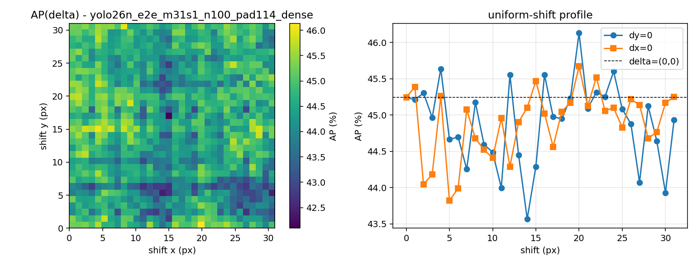
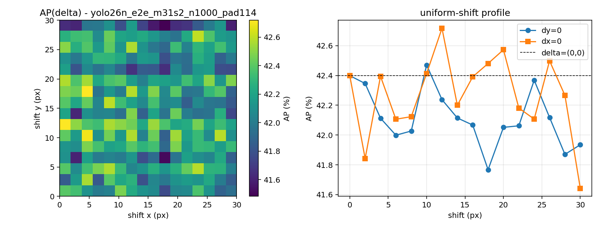
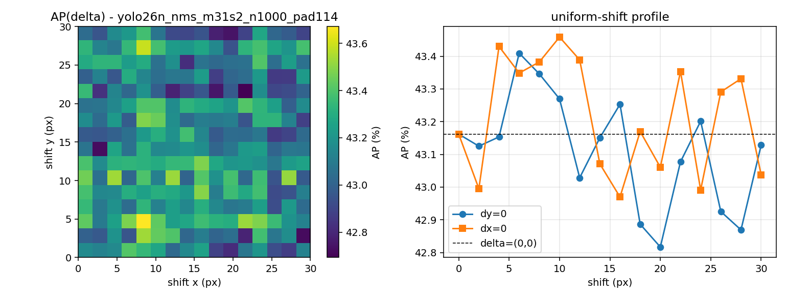
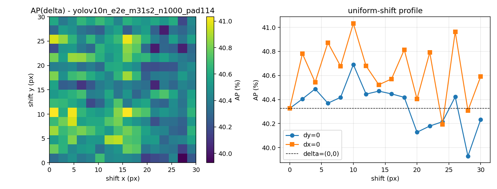
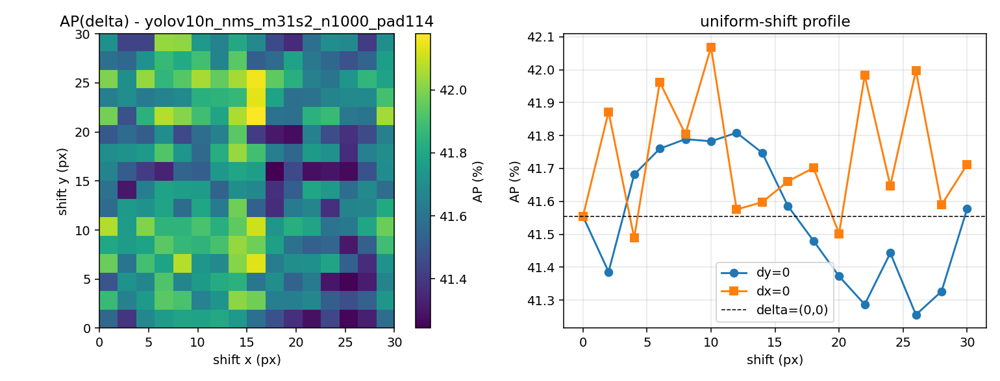

# Shift equivariance of NMS-free real-time detectors

## Phase-0 gates
| gate | pass | detail |
|---|---|---|
| ap_noise_floor | None | "" |
| cache_benefit | None | "" |
| cache_benefit_w1 | None | "" |
| cache_benefit_w2 | None | "" |
| detection_diff_nms | None | "" |
| fusion_delta | None | "" |
| gateA_reproduce | True | [] |
| gateA_rtdetr-l | False | ["e2e: got 52.775, published 53.0, delta -0.225 > tol 0.1"] |
| gateA_yolo11n | True | [] |
| gateA_yolov10n | True | [] |
| gateA_yolov8n | True | [] |
| gateB_harness | True | {"B1_preproc_identity": true, "B2_deshift_roundtrip": true, "B2b_map_equivariance": true, "B3_determinism": tr |
| gateB_harness_nms | True | {"B1_preproc_identity": true, "B2_deshift_roundtrip": true, "B2b_map_equivariance": true, "B3_determinism": tr |
| gateB_identity_fullval | False | ["e2e: ours 40.220 vs Ultralytics square 40.255, delta -0.034 > tol 0.02", "nms: ours 40.834 vs Ultralytics sq |
| maxdet_ladder | None | "" |
| numerics_control | None | "" |
| numerics_probe_nms | None | "" |
| protocol_probe | None | "" |
| rtdetr_protocol_probe | None | "" |
| topk_probe | None | "" |

## Table 1 - Oracle envelope (Manfredi & Wang dAP)

Per-image adversarial shift selection, greedy Algorithm 1. Comparable to prior work only at M=1. **This is not the range of AP over uniform shifts.**

Reference values from Manfredi & Wang (COCO val, M=1): RetinaNet dAP 2.2 / dAP50 5.1, FasterRCNN 2.9 / 6.4, CenterNet 3.4 / 8.1.

| model | head | M | N | area | baseline_AP | AP_worst | AP_best | dAP | dAP50 | comparable |
|---|---|---|---|---|---|---|---|---|---|---|
| yolo26n | e2e | 1 | 5000 | all | 40.25 | 38.18 | 41.94 | 3.76 | 6.96 | True |
| yolo26n | e2e | 1 | 5000 | all | 40.25 | 38.12 | 41.96 | 3.83 | 7.14 | True |
| yolo26n | nms | 1 | 5000 | all | 40.90 | 39.23 | 42.48 | 3.25 | 6.08 | True |
| yolo26n | nms | 1 | 5000 | all | 40.90 | 39.19 | 42.53 | 3.34 | 6.26 | True |
| yolov10n | e2e | 1 | 5000 | all | 38.45 | 36.57 | 40.24 | 3.67 | 6.57 | True |
| yolov10n | nms | 1 | 5000 | all | 39.52 | 38.10 | 40.99 | 2.89 | 5.49 | True |

## Table 2 - Uniform-shift curve AP(delta)

Every image shifted by the same delta; each point is an ordinary COCO AP. `AP_range` is the honest cost of a translation in deployment.

| model | head | N | step | shifts | pad | AP@0 | AP_min | AP_max | AP_range | AP_std | APs_range | APm_range | APl_range | argmin | argmax |
|---|---|---|---|---|---|---|---|---|---|---|---|---|---|---|---|
| yolo26n | e2e | 100 | 1 | 1024 | 114 | 45.24 | 42.09 | 46.13 | 4.04 | 0.65 | 6.66 | 7.05 | 6.28 | [17, 15] | [0, 20] |
| yolo26n | e2e | 1000 | 2 | 256 | 114 | 42.40 | 41.48 | 42.72 | 1.23 | 0.24 | 2.59 | 1.99 | 2.28 | [30, 18] | [18, 4] |
| yolo26n | nms | 1000 | 2 | 256 | 114 | 43.16 | 42.69 | 43.67 | 0.98 | 0.19 | 1.96 | 2.01 | 2.42 | [22, 22] | [4, 8] |
| yolov10n | e2e | 1000 | 2 | 256 | 114 | 40.33 | 39.93 | 41.03 | 1.10 | 0.20 | 2.56 | 2.06 | 2.21 | [0, 28] | [10, 0] |
| yolov10n | nms | 1000 | 2 | 256 | 114 | 41.55 | 41.24 | 42.18 | 0.93 | 0.20 | 2.64 | 1.75 | 1.89 | [16, 18] | [22, 16] |

## Table 3 - Instance-level instability

| model | head | tau | n_gt | flicker | dropout | class_flip | jitter_px | jitter_rel | flicker_small | flicker_med | flicker_large | jitter_small |
|---|---|---|---|---|---|---|---|---|---|---|---|---|
| yolo26n | e2e | 0.25 | 749 | 48.46 | 63.16 | 8.69 | 1.904 | 0.032 | 41.72 | 58.52 | 44.63 | 0.929 |
| yolo26n | e2e | 0.25 | 6896 | 39.17 | 46.49 | 7.65 | 1.751 | 0.029 | 37.33 | 48.34 | 30.46 | 0.867 |
| yolo26n | nms | 0.25 | 6896 | 30.23 | 28.83 | 8.15 | 1.851 | 0.031 | 33.21 | 36.57 | 16.63 | 0.904 |
| yolov10n | e2e | 0.25 | 6896 | 36.80 | 45.36 | 7.23 | 1.691 | 0.027 | 34.77 | 46.84 | 27.32 | 0.839 |
| yolov10n | nms | 0.25 | 6896 | 28.41 | 27.60 | 7.69 | 1.756 | 0.029 | 30.45 | 34.76 | 16.45 | 0.909 |

## Figures

